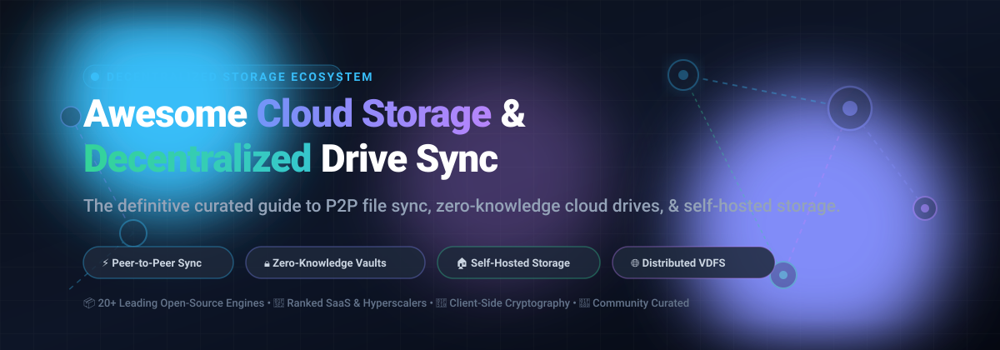

  

# 🚀 Awesome Cloud Storage & Decentralized Drive Sync

  
  
  
  
  
  

---

## 🌟 Top Cloud Storage & Decentralized Drive Sync Ecosystem

> **The definitive curated directory of SaaS/hosted cloud storage platforms & open-source GitHub projects.**  
> *Engineered for peer-to-peer (P2P) file synchronization, virtual drive mounts (VDFS/FUSE), zero-knowledge end-to-end encrypted vaults, self-hosted private clouds, and distributed object storage.*

**Last updated: November 2026** 📅

This repository tracks notable **SaaS/hosted platforms** and **open-source projects** for **Cloud Storage & Decentralized Drive Sync**. These tools synchronize, index, mount, encrypt, and distribute files across local devices, personal servers, S3 buckets, and peer-to-peer networks without relying exclusively on centralized cloud silos.

- 🏢 **Enterprise & Consumer SaaS Leaders:** Microsoft OneDrive, Google Drive, Dropbox, Box, pCloud, MEGA, Sync.com, Icedrive, Nextcloud Hub, and Tresorit.
- 💻 **Open-Source Champions:** Decentralized/P2P virtual drives (`Spacedrive`, `Syncthing`, `Peergos`, `IPFS`), self-hosted cloud collaboration platforms (`Nextcloud`, `Seafile`, `ownCloud Infinite Scale`, `OpenCloud`), local device transfers (`LocalSend`), high-performance object stores (`MinIO`, `Garage`), enterprise multi-protocol gateways (`SFTPGo`, `FileBrowser`), distributed filesystems (`JuiceFS`), and encrypted virtual multi-cloud mounters (`rclone`, `Cryptomator`, `Restic`, `Kopia`, `BorgBackup`).

Contributions welcome! 🤝 Open a Pull Request to suggest new entries or updates. Please keep descriptions factual and link to official documentation.

---

## 📑 Table of Contents

- [📊 Sector Overview & Market Dynamics](#-sector-overview--market-dynamics)
- [🏢 SaaS/Hosted Platforms](#-saashosted-platforms)
- [💻 Open-Source GitHub Projects](#-open-source-github-projects)
  - [🔄 Peer-to-Peer & Decentralized File Synchronization](#-peer-to-peer--decentralized-file-synchronization)
  - [🏠 Self-Hosted Cloud Drives & Collaboration Hubs](#-self-hosted-cloud-drives--collaboration-hubs)
  - [🗄️ Object Storage & Distributed Filesystems](#️-object-storage--distributed-filesystems)
  - [🔒 Client-Side Encryption, Virtual Mounts & Backup Engines](#-client-side-encryption-virtual-mounts--backup-engines)
  - [🌐 Web File Managers & Multi-Protocol Access](#-web-file-managers--multi-protocol-access)
- [🛠️ Architecture Recipes for Custom Systems](#️-architecture-recipes-for-custom-systems)
- [🤝 How to Contribute](#-how-to-contribute)
- [⭐ Star History](#-star-history)
- [💖 Support & Share](#-support--share)
- [⚠️ Disclaimer](#️-disclaimer)

---

## 📊 Sector Overview & Market Dynamics

The global cloud storage market is estimated at approximately **$180 billion to $200 billion in 2026**, projected to exceed **$500 billion by the early 2030s** driven by exponential generative-AI datasets, remote collaboration, and enterprise multi-cloud migrations. 

The sector exhibits a **highly concentrated, oligopolistic structure** at the foundational hyperscale tier—where the "Big Three" (Microsoft Azure, Google Cloud, and AWS) control over 60% of enterprise infrastructure spend. Concurrently, the consumer and developer layers remain **moderately fragmented**, with agile challengers driving fierce competition around zero-knowledge cryptography, client-side data sovereignty, decentralized peer-to-peer networks, and self-hosted private cloud ecosystems.

---

## 🏢 SaaS/Hosted Platforms

| Platform | Company Scale (Revenue / Valuation) | Pricing (Starting Tier) | Free Tier Limit | Description |
| :--- | :--- | :--- | :--- | :--- |
| **[Microsoft OneDrive](https://microsoft.com)** | ~$3.7T Market Cap / ~$245B+ Annual Revenue | $1.99/mo ($19.99/yr) for Microsoft 365 Basic (100 GB) | 5 GB free forever storage with a Microsoft account | Deeply integrated Windows and Microsoft 365 cloud file sync service featuring Files On-Demand virtual mounting and Personal Vault 2FA storage. |
| **[Google Drive (Google Workspace)](https://google.com)** | ~$3.4T Market Cap (Alphabet) / ~$350B+ Annual Revenue | $1.99/mo for Google One (100 GB); $7.00/user/mo for Workspace Starter (30 GB/user) | 15 GB free forever pooled across Drive, Gmail, and Google Photos | Ubiquitous cloud file storage, desktop virtual drive streaming, real-time document collaboration, and AI-indexed workspace platform. |
| **[Dropbox](https://dropbox.com)** | ~$7.3B Market Cap / ~$2.53B Annual Revenue | $9.99/mo (billed annually at $119.88/yr) for Plus (2 TB) | 2 GB free forever storage, max 3 connected devices, 30-day version history | Cross-platform cloud file sync, block-level delta transfer, virtual smart-sync drive, and team collaboration platform. |
| **[Box](https://box.com)** | ~$5.9B Market Cap / ~$1.23B Annual Revenue | $10.00/mo (billed annually) for Personal Pro (100 GB) or $5.00/user/mo for Business Starter (3-user min) | 10 GB free forever storage, 250 MB single file upload limit | Enterprise cloud content management and workflow platform offering granular governance, virtual drive desktop access, and customer-managed encryption keys. |
| **[Tresorit](https://tresorit.com)** | ~$7.3B Parent Turnover (Swiss Post) / ~$15M standalone ARR estimate | $5.59/mo (billed annually) for Personal Lite (50 GB); 14-day free trial on paid tiers | 3 GB free forever storage (Tresorit Basic), max 2 devices, 500 MB file upload limit | Enterprise zero-knowledge end-to-end encrypted cloud storage and secure file-synchronization suite built for regulated industries. |
| **[MEGA](https://mega.io)** | ~$60M–$65M Annual Revenue / Private (~338M+ registered accounts) | €10.62/mo (~$11.50/mo or €119/yr) for Pro I (2 TB storage, 2 TB transfer) | 20 GB free forever encrypted storage (with dynamic bandwidth limits) | User-controlled end-to-end encrypted cloud drive, desktop folder sync, and secure file-transfer service with zero-knowledge key management. |
| **[pCloud](https://pcloud.com)** | ~$10M–$15M Annual Revenue / Private (~22M+ users) | $4.99/mo (or $49.99/yr, $199 lifetime) for Premium (500 GB) | 10 GB free forever storage (unlocked via onboarding steps) | Cloud storage platform providing virtual drive mounting (`pCloud Drive`), lifetime storage plans, and optional client-side zero-knowledge encryption (`pCloud Crypto`). |
| **[Nextcloud Hub (Hosted Enterprise / Managed Providers)](https://nextcloud.com)** | ~$5M–$10M Annual Revenue / Private | ~€5.00 to €15.00/user/mo via managed providers, or €68.00/user/yr for Nextcloud Enterprise (100-user min) | 100% free & open-source for self-hosting with unlimited users & storage (managed SaaS hosts typically offer 2 GB to 5 GB free trials) | Managed enterprise hosting and commercial support tiers for Nextcloud Hub, combining cloud drive sync, office collaboration, and communication tools. |
| **[Sync.com](https://sync.com)** | ~$5.1M Annual ARR / Bootstrapped & Private | $8.00/mo (billed annually at $96/yr) for Solo Basic (2 TB) | 5 GB free forever zero-knowledge storage, max 5 connected devices, 3 share links | Privacy-first cloud storage and file sync platform offering default client-side end-to-end encryption, granular link permissions, and compliance auditing. |
| **[Icedrive](https://icedrive.net)** | ~$1M–$3M Est. Annual Revenue / Private Bootstrapped | $2.99/mo (or $19.99/yr) for Lite (150 GB) | 10 GB free forever storage, 50 GB monthly bandwidth limit (no zero-knowledge encryption on free tier) | Modern cloud storage service featuring Twofish client-side encryption, virtual drive integration, and fast browser/mobile media streaming. |

---

## 💻 Open-Source GitHub Projects

*Ranked strictly in descending order by GitHub_Stars.*

### 🔄 Peer-to-Peer & Decentralized File Synchronization

- **[LocalSend](https://github.com/localsend/localsend)**   
  An open-source cross-platform peer-to-peer file and folder transfer suite that communicates securely over the local Wi-Fi network without relying on third-party cloud servers.

- **[Syncthing](https://github.com/syncthing/syncthing)**   
  The flagship continuous, decentralized peer-to-peer file synchronization utility written in Go that synchronizes files directly across devices over TLS without centralized data interception.

- **[Spacedrive](https://github.com/spacedriveapp/spacedrive)**   
  An open-source cross-platform file explorer and virtual distributed filesystem (VDFS) written in Rust that unifies local hard drives, cloud drives, and remote nodes into an encrypted mesh.

- **[IPFS Kubo](https://github.com/ipfs/kubo)**   
  The foundational Go implementation of the InterPlanetary File System (IPFS)—a peer-to-peer hypermedia protocol for content-addressed, tamper-proof decentralized storage and distribution.

- **[Perkeep](https://github.com/perkeep/perkeep)**   
  Open-source personal storage system written in Go modeled to store, sync, share, back up, and organize content-addressed personal life data across private and cloud endpoints.

- **[Peergos](https://github.com/Peergos/Peergos)**   
  A decentralized, quantum-resistant, end-to-end encrypted cloud storage and social collaboration platform built on IPFS with total metadata privacy.

---

### 🏠 Self-Hosted Cloud Drives & Collaboration Hubs

- **[Nextcloud Server](https://github.com/nextcloud/server)**   
  The industry-standard self-hosted open-source productivity and private cloud storage platform with virtual file sync clients, collaborative document editing, and granular sharing controls.

- **[Seafile](https://github.com/haiwen/seafile)**   
  High-performance open-source cloud file sync and share system featuring Git-like block-level delta synchronization, virtual drive streaming (`SeaDrive`), and client-side encryption.

- **[OpenCloud](https://github.com/opencloud-eu/opencloud)**   
  A modern, high-concurrency cloud-native file sync and sharing platform built in Go microservices, architected for European digital sovereignty, open standards, and high-performance S3 backends.

- **[Pydio Cells](https://github.com/pydio/cells)**   
  A mature enterprise-grade file sync and content collaboration engine rewritten as a lightweight Golang microservices platform with native S3 compatibility.

- **[ownCloud Infinite Scale (oCIS)](https://github.com/owncloud/ocis)**   
  A cloud-native file sync and sharing platform compiled into a single self-contained Go binary with zero database dependencies and high-speed POSIX/S3 compatibility.

---

### 🗄️ Object Storage & Distributed Filesystems

- **[MinIO](https://github.com/minio/minio)**   
  High-performance Kubernetes-native object storage suite with 100% S3 API compatibility designed for cloud-native AI pipelines, large-scale data lakes, and private cloud architectures.

- **[JuiceFS](https://github.com/juicedata/juicefs)**   
  High-performance POSIX-compliant distributed filesystem engineered on top of Redis/SQL metadata engines and scalable S3 object storage backends.

- **[Garage](https://github.com/deuxfleurs-org/garage)**   
  Lightweight, geo-distributed, self-hosted S3-compatible object storage daemon written in Rust, purpose-built for homelabs, edge nodes, and decentralized multi-datacenter clusters.

---

### 🔒 Client-Side Encryption, Virtual Mounts & Backup Engines

- **[rclone](https://github.com/rclone/rclone)**   
  The "Swiss Army knife" of cloud storage: an essential command-line utility and FUSE virtual drive mounter supporting 70+ cloud remotes, S3/WebDAV, bidirectional sync, and transparent `crypt` encryption.

- **[Restic](https://github.com/restic/restic)**   
  A fast, secure, efficient backup program written in Go that uses cryptographic deduplication to back up files to local drives, SFTP, and cloud object stores (S3, B2, Azure).

- **[Cryptomator](https://github.com/cryptomator/cryptomator)**   
  Multi-platform client-side encryption utility that creates transparently encrypted virtual hard drives inside Dropbox, Google Drive, OneDrive, or any local sync directory.

- **[Kopia](https://github.com/kopia/kopia)**   
  Fast and secure open-source backup tool for Windows, macOS, and Linux that provides client-side encryption, content-addressed deduplication, snapshots, and virtual mount capabilities.

- **[BorgBackup (Borg)](https://github.com/borgbackup/borg)**   
  Deduplicating authenticated backup program supporting authenticated encryption, compression, and remote repository access via SSH.

- **[Duplicati](https://github.com/duplicati/duplicati)**   
  Free backup software to securely store encrypted, incremental, compressed backups on cloud storage providers and remote file servers.

- **[git-annex](https://git-annex.branchable.com/)**  
  Manage, track, and sync huge binary files and multimedia collections across distributed hard drives, removable USB storage, and remote cloud targets without checking contents directly into Git.

---

### 🌐 Web File Managers & Multi-Protocol Access

- **[FileBrowser](https://github.com/filebrowser/filebrowser)**   
  Sleek, lightweight web-based file manager written in Go providing an interactive web interface to upload, manage, edit, and share files on a server or NAS within seconds.

- **[SFTPGo](https://github.com/drakkan/sftpgo)**   
  Fully featured and highly configurable event-driven file transfer solution supporting SFTP, HTTP/S, FTP/S, and WebDAV with local and cloud storage backends (S3, GCS, Azure Blob).

---

## 🛠️ Architecture Recipes for Custom Systems

| Architectural Goal | Recommended Stack | Capabilities & Strengths |
| :--- | :--- | :--- |
| **Serverless Peer-to-Peer Sync** | `Syncthing` + `LocalSend` | Direct LAN and internet sync with zero external cloud dependencies or subscription fees. |
| **Unified Virtual Filesystem Mesh** | `Spacedrive` + `rclone` | Consolidate disparate physical disks, cloud buckets, and network shares into a single indexable drive. |
| **Self-Hosted Zero-Trust Cloud** | `Nextcloud Server` + `Cryptomator` | Enterprise-grade web collaboration and sync paired with client-side zero-knowledge encryption. |
| **Geo-Distributed S3 Private Storage** | `Garage` or `MinIO` + `JuiceFS` | Highly resilient POSIX distributed filesystem powered by inexpensive multi-datacenter commodity nodes. |
| **Encrypted Immutable Backup Pipeline** | `Restic` or `Kopia` + `Backblaze B2` / `Wasabi` | Content-addressed cryptographic deduplication with snapshot mounting and point-in-time rollbacks. |

---

## 🤝 How to Contribute

Contributions are warmly encouraged! Follow these simple steps:

1. 🍴 **Fork the repository** on GitHub.
2. 🌿 **Create a topic branch** (`git checkout -b feature/add-new-storage-tool`).
3. ✏️ **Add or update entries** in `README.md` following the standardized format and tables.
4. 🏷️ **Ensure accurate categories, links, and pricing/star details**.
5. 🚀 **Submit a Pull Request** with a concise description of your additions.

---

## ⭐ Star History

---

## 💖 Support & Share

Thank you for exploring this curated repository! If you find this guide helpful for architecting your homelab, securing your private data, or building decentralized sync infrastructure, please consider supporting the project:

- ⭐ **Star this repository** on GitHub to amplify its reach and help more developers discover it.
- 🍴 **Fork and share** the link with your team, friends, and community on X/Twitter, Reddit, and LinkedIn.
- ☕ **Sponsor my open-source work**: Support continuous maintenance and additions by buying me a coffee on the [GitHub Sponsors Dashboard](https://github.com/sponsors/ishandutta2007).

  

---

## ⚠️ Disclaimer

- This is an **independent community-curated resource** — inclusion does not constitute a formal commercial endorsement.
- Continuous peer-to-peer sync systems (e.g., `Syncthing`) immediately propagate file modifications and deletions across paired nodes; always maintain isolated, immutable, and versioned backups (e.g., via `Restic`, `Kopia`, or `BorgBackup`).
- With client-side zero-knowledge encryption systems (such as `Cryptomator` or `rclone crypt`), losing your master password or recovery key permanently renders your encrypted files unrecoverable.

---

  <b>Built with ❤️ for privacy advocates, homelab builders, distributed teams, sysadmins, and open-source contributors.</b> 
  <i>Let's make cloud storage and decentralized drive synchronization more resilient, open, and user-owned.</i>

# Awesome-Cloud-Storage-Decentralized-Drive-Sync

# Awesome Cloud Storage & Decentralized Drive Sync 🌟

> **Top Cloud Storage Decentralized Drive Sync (Opensource)**  
> A curated list of the best cloud storage, file synchronization, and decentralized drive solutions — with a strong focus on **open-source** and self-hostable alternatives.  
> 🌟 **Star if you like it!** 🌟

Cloud storage and file sync services keep documents, photos, and data accessible across devices. Commercial platforms such as Dropbox, Google Drive, OneDrive, MEGA, and Tresorit dominate the hosted space, while a mature open-source ecosystem offers full data ownership through self-hosted servers (Nextcloud, Seafile), peer-to-peer sync (Syncthing), and decentralized networks (IPFS, Sia, Storj-related projects).

This list prioritizes **open-source GitHub projects and self-hostable tools** while keeping SaaS/hosted platforms clearly separated.

## Table of Contents

- [SaaS / Hosted Platforms](#saas--hosted-platforms)
- [Open-Source GitHub Projects](#open-source-github-projects)
- [How to Contribute](#how-to-contribute)
- [Disclaimer](#disclaimer)

## SaaS / Hosted Platforms

These are popular commercial cloud storage and encrypted drive services (closed-source / hosted):

- **[Dropbox](https://www.dropbox.com/)** — Classic file sync and sharing platform with strong collaboration features.
- **[Google Drive](https://drive.google.com/)** — Integrated cloud storage tightly coupled with Google Workspace.
- **[OneDrive](https://www.microsoft.com/en-us/microsoft-365/onedrive/online-cloud-storage)** — Microsoft’s cloud storage, deeply integrated with Windows and Microsoft 365.
- **[Box](https://www.box.com/)** — Enterprise-focused content management and collaboration platform.
- **[pCloud](https://www.pcloud.com/)** — European cloud storage with client-side encryption options and lifetime plans.
- **[MEGA](https://mega.nz/)** — Privacy-oriented cloud storage with end-to-end encryption and generous free tiers.
- **[Sync.com](https://www.sync.com/)** — Canadian zero-knowledge encrypted cloud storage.
- **[Icedrive](https://icedrive.net/)** — Modern cloud storage with strong encryption and competitive pricing.
- **[Tresorit](https://tresorit.com/)** — High-security end-to-end encrypted cloud storage aimed at businesses and privacy-conscious users.
- **[Nextcloud Hub](https://nextcloud.com/)** — Hosted/managed offering of the popular open-source platform (commercial support available).

## Open-Source GitHub Projects

Open-source alternatives and self-hostable tools for file synchronization, personal clouds, and decentralized storage. These give you full control over your data.

### Self-Hosted Personal Cloud & File Sync

- **[nextcloud/server](https://github.com/nextcloud/server)** (Nextcloud)  
  The leading open-source personal cloud platform. File sync & share, calendar, contacts, office suites (Collabora/OnlyOffice), Talk, and a large app ecosystem. Closest full-featured alternative to Google Drive / Dropbox. AGPL-3.0.

- **[haiwen/seafile](https://github.com/haiwen/seafile)** (Seafile)  
  High-performance open-source file sync and share platform. Excellent delta sync, library-based organization, and strong reliability with large numbers of files. Community Edition is fully open-source.

- **[owncloud/core](https://github.com/owncloud/core)** (ownCloud)  
  Mature open-source file sync and collaboration platform. Focus on enterprise features, sharing, and integration. AGPL.

- **[pydio/cells](https://github.com/pydio/cells)** (Pydio Cells)  
  Modern open-source content collaboration platform with strong sharing and external collaboration capabilities.

### Peer-to-Peer & Lightweight Sync

- **[syncthing/syncthing](https://github.com/syncthing/syncthing)**  
  Continuous peer-to-peer file synchronization. No central server required — devices sync directly with each other. Extremely lightweight, private, and reliable. MPL-2.0. One of the most popular open-source sync tools.

- **rclone**  
  Command-line program to manage files on cloud storage. Supports dozens of providers (including S3-compatible, Google Drive, Dropbox, etc.) and can be used for backups, mounts, and synchronization.

### Decentralized & Distributed Storage

- **IPFS (InterPlanetary File System)** — [ipfs/kubo](https://github.com/ipfs/kubo) and related projects  
  Content-addressed, peer-to-peer distributed file system. Foundation for many decentralized storage solutions.

- **Sia / SiaFoundation projects**  
  Decentralized cloud storage network with open-source host and renter software. Files are encrypted, erasure-coded, and distributed across hosts.

- **Storj-related open-source components and connectors**  
  Decentralized object storage with S3-compatible APIs and community tools for integration with IPFS and other systems.

- **Filecoin ecosystem tools**  
  Incentivized decentralized storage layer often used together with IPFS for persistent, verifiable storage.

### Other Notable Open-Source Projects

- **[spacedriveapp/spacedrive](https://github.com/spacedriveapp/spacedrive)**  
  Open-source cross-platform file explorer powered by a virtual distributed filesystem written in Rust. Aims to unify local and remote storage in one interface.

- **[spacesdrive/twiligent](https://github.com/spacesdrive/twiligent)**  
  Self-hosted analytics and publishing dashboard (YouTube + Instagram focus). Included as referenced; demonstrates privacy-first, locally controlled data tools in a related domain.

- Additional tools such as SFTPGo, SeaweedFS, MinIO (S3-compatible object storage), and various WebDAV/SFTP servers that complement personal cloud setups.

> **Tip**: For a full Google Drive / Dropbox-style experience self-host **Nextcloud**. For maximum sync speed and reliability with large libraries try **Seafile**. For pure device-to-device sync with zero central server use **Syncthing**. Decentralized options (IPFS + Filecoin/Sia/Storj) suit censorship resistance and long-term archival use cases.

## How to Contribute

Contributions are welcome and encouraged!

1. Fork the repository
2. Add a new tool under the appropriate section (keep SaaS and Open-Source strictly separate)
3. Use the same format: **Name** — short description + key features + license/link
4. Prefer actively maintained projects with clear documentation, security track records, and preferably cross-platform clients
5. Submit a Pull Request

Please keep descriptions neutral and factual. Open-source and self-hostable projects are the primary focus of this list. Clearly note any enterprise editions or dual-licensing.

## Disclaimer

This is a community-curated list for informational and educational purposes only.  
Inclusion does not constitute an endorsement.  

Self-hosting means you are responsible for backups, security updates, encryption key management, and availability. Decentralized networks involve additional complexity (tokens, hosts, retrieval). Always review licenses, threat models, and operational requirements before migrating critical data.

Commercial services offer convenience and support at the cost of trusting a third party with your files. Choose according to your privacy needs, technical ability, and budget.

---

**Made with ❤️ for the open-source privacy and self-hosting community**  
If this list helped you, please ⭐ the repo!
